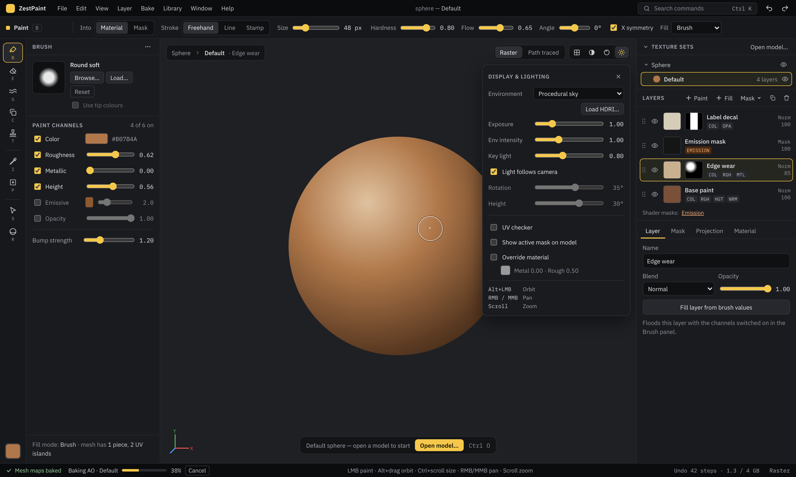

# ZestPaint

ZestPaint is a 3D texture-painting app in the spirit of Adobe Substance 3D
Painter. It is written from scratch in Rust on Vulkan (through [vulkano]),
with an [egui] interface, and runs natively on Linux.

It is a tool for **texturing 3D models**. You load a model (FBX or glTF),
paint PBR channels straight onto it in a layer stack with masks, bake mesh
maps, generate smart masks, and export texture maps for a game engine or
renderer. It handles models made of dozens of pieces and materials. On top
of that it has a studio for posing and rendering rigged characters, masks
for toon shaders, a built-in AI assistant, and an MCP server so Claude Code
can drive the editor.



---

## How it is like Substance Painter

If you know Substance Painter, most of ZestPaint will feel familiar. The
core workflow is the same:

| Substance Painter | ZestPaint |
| --- | --- |
| **Texture sets** per material | Same. An FBX body mesh with Body / Face / Eyes materials becomes three independent sets, each with its own layers, bakes and resolution. |
| **Layer stack** of paint and fill layers | Paint layers and fill layers with opacity, blend modes, masks, duplicate / merge / reorder. |
| **Fill layer + black mask** to paint a material in | Applying a library material creates a fill layer with a black mask and switches the brush to mask mode. |
| **Channels**: base colour, roughness, metallic, height, normal, emissive, opacity | Same channels. Height derives a normal map automatically, and it blends with any normal map in the stack. |
| **Projection painting** with symmetry | Screen-space brush projected onto the mesh with depth occlusion and backface rejection, so you can't paint through the model. X-symmetry, brush tips, stamps, line strokes. |
| **Mesh-map baking**: AO, curvature, position, world normal | Same four bakers, on the GPU. The whole scene occludes AO, so clothes shadow the body. |
| **Smart masks** (edge wear, dirt) | Edge-wear and cavity-dirt generators per layer, with amount and contrast. |
| **Tri-planar / projected fills** | Triplanar, planar, spherical and cylindrical projections, with a Place tool (P) to move, turn and size them on the model. |
| **Clone, smudge, eraser, colour picker, polygon fill** | All present, plus fill by triangle, UV island or whole piece (the last one is a paint bucket). |
| **Iray** path-traced viewport | A progressive compute path tracer you can toggle in the viewport. |
| **UDIM** | Multi-tile UVs split into one texture set per tile at import. |
| **Shelf** of materials and brushes | Material and brush library window, with tags, search and thumbnails. |
| **Export** with naming per map and per set | Export dialog with map, set and size choices, presets, and per-layer / per-mask export. |
| **Project file** | `.zestpaint` project files that store everything needed to keep painting. |

---

## How it differs from Substance Painter

### What ZestPaint adds or does differently

- **Free and open source (GPLv3), Linux-native.** No subscription and no
  account. It is a Rust + Vulkan app you build yourself.
- **Built for models with many parts.**
  - **Piece management with Blender keys** for models with 90+ pieces: click
    to select, H / Shift H / Alt H to hide, `/` for local view, F to frame.
    Hidden pieces don't block painting or baking, so you can isolate one
    part and paint what is underneath it.
  - **Per-set resolution** from 1K to 8K, with a GPU-memory estimate, so a
    small UV area that needs fine detail can get more texels.
- **Toon-shader masks.** Shader-mask layers for stylised shaders such as
  Poiyomi and lilToon: Emission, Matcap, Rim light, Outline, Shadow,
  Specular, Glitter, Detail, Dissolve, AudioLink and Custom masks. You paint
  them like any other layer, and they export as `<name>_matcap_mask.png`,
  `_rim_light_mask.png` and so on. **Matcap layers** preview matcaps in the
  viewport, using 15 built-ins or any matcap image.
- **Studio: posing, lighting and rendering** (F10 / F12). Rigged models
  keep their skeleton. Pose them with built-in photography poses, any frame
  of a Mixamo / glTF / BVH animation, or saved poses. Light them with classic
  portrait setups, put them on a studio sweep, and render a path-traced PNG,
  optionally with a transparent background and shadow catcher. Bone names
  from Mixamo, Unity/CATS, Unreal, VRoid and Daz are mapped automatically,
  and poses retarget between T-pose and A-pose rigs.
- **AI assistant built in** (F9). It chats with Claude or Gemini, can see the
  viewport, and has tools to set up layers, materials, brushes, masks and
  stamps. It can design a tattoo as SVG or generate one as an image (Nano
  Banana or your own local ComfyUI), find CC0 materials and download them,
  and make splatter / blood brushes. See [AI assistant](#ai-assistant) below.
- **Claude Code integration.** The running app is also an MCP server, so
  Claude Code can drive it with the same tools. See
  [Claude Code (MCP)](#claude-code-mcp).
- **Photoshop-style layer features:** 17 blend modes (Normal, Multiply,
  Screen, Overlay, Soft/Hard Light, Dodge/Burn, Difference, Hue, Colour,
  Luminosity…), clipping layers, mask on/off, mask from another layer's
  coverage, merge down (Ctrl E).
- **Imports GIMP and Photoshop brushes** (`.gbr`, `.gih`, `.abr`) and plain
  images as brush tips and stamps.
- **CC0 asset tooling.** The bundled `matfetch` tool mirrors ambientCG and
  Poly Haven into a local library, and generates procedural assets that
  aren't available in CC0: lace, tulle, stitches, zippers, grommets, snaps
  and splatter stamps.
- **One undo history for the whole document.** Strokes, layer settings,
  fills, bakes, visibility, material slots and UV unwraps are all undoable,
  limited by a RAM budget rather than a fixed step count.
- **Open project format:** a `.zestpaint` file is a zip of a JSON manifest,
  meshes, and raw half-float textures.
- **Built-in UV auto-unwrap** ([xatlas]) for one texture set at a time,
  for models with missing or overlapping UVs.

### What Substance Painter has that ZestPaint doesn't (yet)

- **No procedural Substance materials.** There's no node graph and no
  `.sbsar` support. Materials are bitmap texture folders (ambientCG / Poly
  Haven style), and "smart materials" are a fill layer plus a generated mask.
- **No pen pressure** yet, no layer folders/groups, no anchor points and no
  particle brushes.
- **Fewer bakers.** There's no thickness or ID baking, and no baking from a
  high-poly mesh.
- **Shading is an OpenPBR-style subset** (coat, sheen, emission, specular
  weight). It has no transmission, subsurface, thin film or anisotropy. The
  path tracer doesn't do coat, sheen, transmission or subsurface either.
- **No engine export templates** (packed ORM, Unreal/Unity presets). It
  exports one PNG per map.
- Bakes and exports block the UI while they run.
- Re-unwrapping a texture set resets that set's layers, because paint can't
  survive a UV change.
- Manual UV island editing is future work.

---

## Features in more detail

- **Viewports:** real-time raster (Cook-Torrance GGX with image-based
  lighting, ACES tone mapping, skybox) or a progressive path-traced
  preview. Painting happens in raster mode.
- **Environments:** a procedural sky, or any equirectangular `.hdr`
  convolved into IBL cubemaps on the GPU. The key light can be steered.
- **Model import:** `.fbx` through [ufbx] (any version; units and axes
  normalised; embedded or on-disk textures) and `.gltf` / `.glb`. Base
  colour, roughness, metallic, normal, height, AO, emission and opacity maps
  are picked up where the file has them, and imported in the background.
- **Material maps:** each material has file-loadable slots for base colour,
  roughness, metallic, normal, height, AO and emission. Imported maps are
  stored BC7/BC4/BC5-compressed with mipmaps to save VRAM.
- **Transparency:** per-material opacity and alpha blending, detected from
  FBX/glTF, drawn in a sorted back-to-front pass. Painted opacity
  multiplies in.
- **Tools:** Paint B, Erase E, Smudge G, Clone C (source anchored on the
  model), Stamp T, Pick I, Place P, Select S, Orbit R.
- **Brushes:** hard / soft / airbrush / chalk / spatter / bristle presets,
  greyscale or colour tips, square stamps with rotation, Line and Stamp
  stroke modes.
- **Import maps as layers:** PNGs (including ZestPaint's own per-layer
  exports) come back as new layers. Importing never disturbs existing
  layers.
- **VRAM-aware:** a layer only gets a texture for a channel once that
  channel is painted. Hidden sets release their composites. The status bar
  shows what the driver says ZestPaint holds, with a breakdown on hover.

## Interface

**The left side is how you paint, and the right side is what you paint
into.** The viewport only carries overlays about the view itself. The full
design is in `docs/zestpaint-ui-handover/`.

- **Menu bar:** File, Edit, View, Layer, Bake, Library, Window, Help.
  **Ctrl K** opens a command search.
- **Context bar:** the active tool's options.
- **Tool rail:** tools and the current paint colour.
- **Left dock:** brush tip, presets and paint channels.
- **Right dock:** texture sets, the layer stack, and Layer / Mask /
  Projection / Material tabs.
- **Library window:** a separate OS window with Materials and Brushes &
  stamps tabs.

| Input | Action |
| --- | --- |
| Brush tools: LMB drag | paint / erase / smudge / clone |
| Alt + LMB drag | orbit (while a brush tool is active) |
| Orbit tool: LMB drag | orbit |
| RMB / MMB drag | pan |
| Scroll | zoom |
| Ctrl+Scroll / Shift+Scroll | brush size / tip rotation (Place: size / spin) |
| [ / ] (Shift: faster) | brush size down / up |
| Ctrl+click (Clone) | set the clone source on the model |
| Place tool: drag / Shift+drag | move / rotate the projection |
| Select / Orbit tool: click, Shift+click | select a piece, add/remove it |
| A, Alt A | select all visible pieces, deselect |
| H, Shift H, Alt H | hide selection, hide others, unhide all |
| / (main or numpad) | local view: isolate the selection and frame it; again to leave |
| F (or numpad .), Home | frame selection, frame all |
| Ctrl Z, Ctrl Shift Z (Ctrl Y) | undo / redo (any document edit) |
| Ctrl O, Ctrl Shift I, Ctrl Shift E | open model, import maps, export maps |
| Ctrl S, Ctrl Shift S, Ctrl Shift O | save project, save as, open project |
| Ctrl Shift N, Ctrl J, F2, Del | new paint layer, duplicate, rename, delete |
| Ctrl ] / Ctrl [, Ctrl E | move layer up / down, merge down |
| M, Shift B | material / brush library |
| F5–F8 | toggle Brush, Texture sets, Layers, Properties |
| F9, F10, F12 | assistant, Studio window, render an image |
| F1, Ctrl , | keyboard shortcuts, preferences |

## Building and running

```sh
cargo run --release
```

You need a Vulkan-capable GPU and driver. The first build compiles the
shaders through `vulkano-shaders`. To open a project from the command line,
run `zestpaint file.zestpaint`.

When it starts without a file, ZestPaint shows a welcome screen where you
can open a model or project, or pick a recent one. In Preferences you can
choose to reopen the last project or start on the default sphere instead.

### Material and brush library

Materials live in `~/.zestpaint/library/materials/<name>/` and brushes in
`~/.zestpaint/library/brushes/`. The scanner understands ambientCG, Poly
Haven and cgbookcase file naming. To fill the library:

```sh
cargo run -p matfetch -- --help
```

[ambientCG](https://ambientcg.com) and [Poly Haven](https://polyhaven.com)
are the recommended CC0 sources. Poly Haven HDRIs also work with the
environment loader. For poses, Studio ▸ Pose ▸ Import animation… accepts
Mixamo FBX ("Without Skin"), Quaternius' CC0 animation libraries and CMU's
BVH motion capture.

### Settings

Settings live in `~/.config/zestpaint/` (or `$XDG_CONFIG_HOME/zestpaint/`):

| File | Contents |
| --- | --- |
| `settings.json` | startup behaviour (`welcome`, `last_project`, `default_scene`) and `undo_budget_gb` |
| `assistant.json` | assistant model, **API keys**, ComfyUI URL, MCP port and token. Owner-only (0600). |
| `mcp-bridge.json` | port and token of the running app, for `zestpaint mcp`. Owner-only (0600). |
| `comfy_workflow.json` | optional ComfyUI workflow override for image generation |
| `recent_projects.json`, `export_presets.json`, `hidden_pieces.json` | kept by their features |

## AI assistant

Open it with F9 or the sparkles button on the right edge. It can use:

- **Claude** (Opus 5.5 by default, with Sonnet / Haiku available) with an
  Anthropic API key.
- **Gemini** with a Google AI Studio key. Image generation ("Nano Banana")
  needs billing enabled on that key.
- **ComfyUI** on your own machine, for local image generation with no key.

### API keys: keep them out of the repo

Keys are **never stored in this repository**, and nothing in the repo
should ever contain one. ZestPaint looks for keys in this order:

1. The key field in the assistant's settings (gear icon). It is saved to
   `~/.config/zestpaint/assistant.json` in your home directory with
   owner-only permissions.
2. Environment variables:
   - Claude: `ANTHROPIC_API_KEY`
   - Gemini: `GEMINI_API_KEY`, then `GOOGLE_API_KEY`

```sh
# e.g. in your shell profile, not in a file inside this repo
export GEMINI_API_KEY=...
```

Don't paste a key into `.mcp.json`, a test, a screenshot, a `.zestpaint`
project you share, or an issue. Project files don't contain assistant
settings. `.gitignore` also excludes `.env` files and stray
`assistant.json` / `mcp-bridge.json` copies as a safety net. If a key ever
does get committed, revoke it in the provider's console. Deleting the file
isn't enough, because it stays in git history.

## Claude Code (MCP)

Claude Code can drive the editor with the same tools as the built-in
assistant. You don't need an Anthropic API key for this, because it uses
your Claude Code login.

- The running app listens on a loopback port. Turn it on under Assistant ▸
  settings ▸ *Let Claude Code drive the editor*. The port and a random token
  go into `~/.config/zestpaint/mcp-bridge.json` (owner-only).
- `zestpaint mcp` is the stdio MCP server that Claude Code launches. It
  forwards each tool call to the running app, and its `open_zestpaint` tool
  starts the app if it isn't running. In this repo, `.mcp.json` registers it
  (`cargo run --release -- mcp`). To use it from anywhere, run
  `claude mcp add --scope user zestpaint -- /path/to/zestpaint mcp`.
- The app can also serve MCP over HTTP at `http://127.0.0.1:47821/mcp`
  (plug button in the assistant header). The settings section has the
  `claude mcp add --transport http …` command, including the bearer token.
- `.claude/skills/zestpaint/` is a Claude Code skill with the editor's model
  and recipes for tattoos, splatter and CC0 materials. Copy it to
  `~/.claude/skills/` to use it outside this repo.

Besides the assistant's tools, Claude Code gets `import_model`,
`view_pieces`, `set_texture_resolution`, `set_render_mode`, `import_image`,
`set_view`, `place_stamp` and `set_matcap`. `set_view` and `place_stamp`
answer with a screenshot, so Claude can check what it placed.

## Architecture

The 3D scene renders into an offscreen image that egui shows as a texture in
the central panel. Layer textures store premultiplied alpha in linear space
(RGBA16F for colour, RG16F value + coverage for scalar channels). A GPU
compositor flattens them into per-set composites, and the PBR shader
samples those over each model's own material. Brush strokes are rasterised
in UV space, with the screen-space brush projected per texel.

| Module | Role |
| --- | --- |
| `app.rs`, `app/` | winit shell, egui panels and windows, input routing, undo history, project I/O |
| `renderer.rs` | scene render passes: PBR, skybox, transparency, selection outline, matcaps |
| `environment.rs` | HDRI / procedural sky → irradiance and prefiltered cubemaps (compute) |
| `layers.rs` | layer stack, GPU compositor, blend modes, masks, height → normal, dilation |
| `paint.rs` | UV-space brush projection: paint, erase, smudge, clone, fills |
| `ao.rs`, `bakers.rs` | AO baker; position / normal / curvature maps and smart masks |
| `pathtracer.rs` | progressive compute path tracer (CPU BVH, GGX, studio lights, alpha) |
| `studio.rs`, `skeleton.rs`, `poses.rs` | studio lights / backdrop / lens; skinning and retargeting; pose sources |
| `fbx_loader.rs`, `gltf_loader.rs`, `scene.rs`, `mesh.rs` | model import and CPU scene data |
| `connectivity.rs`, `uv_tools.rs` | mesh shells / UV islands; xatlas auto-unwrap |
| `library.rs`, `brushfile.rs` | material and brush library; GIMP / Photoshop brush parsing |
| `export.rs`, `project.rs` | PNG export; `.zestpaint` project files |
| `matcap.rs`, `texcompress.rs`, `vram.rs` | matcaps; BC compression; VRAM tracking and budget |
| `assistant/` | Claude / Gemini clients, assistant tools, ComfyUI, MCP server and bridge |
| `tools/matfetch` | CLI + library: CC0 catalogue mirror and procedural lace / stitch / splatter assets |

## License

Copyright © 2026 Ryno Kotze.

ZestPaint is free software under the **GNU General Public License, version
3 or (at your option) any later version**. See [LICENSE](LICENSE). You can
use, study, modify and share it. If you distribute it, or a modified
version, you must do so under the same license with the source available.

Under GPLv3 section 7(b) there is one additional term: you must keep
the attribution **"Based on ZestPaint by Ryno Kotze"**, as described in
[NOTICE](NOTICE).

Third-party crates and the bundled fonts (Lucide: ISC, IBM Plex: SIL OFL
1.1) keep their own licenses.

[vulkano]: https://github.com/vulkano-rs/vulkano
[egui]: https://github.com/emilk/egui
[xatlas]: https://github.com/jpcy/xatlas
[ufbx]: https://github.com/ufbx/ufbx
